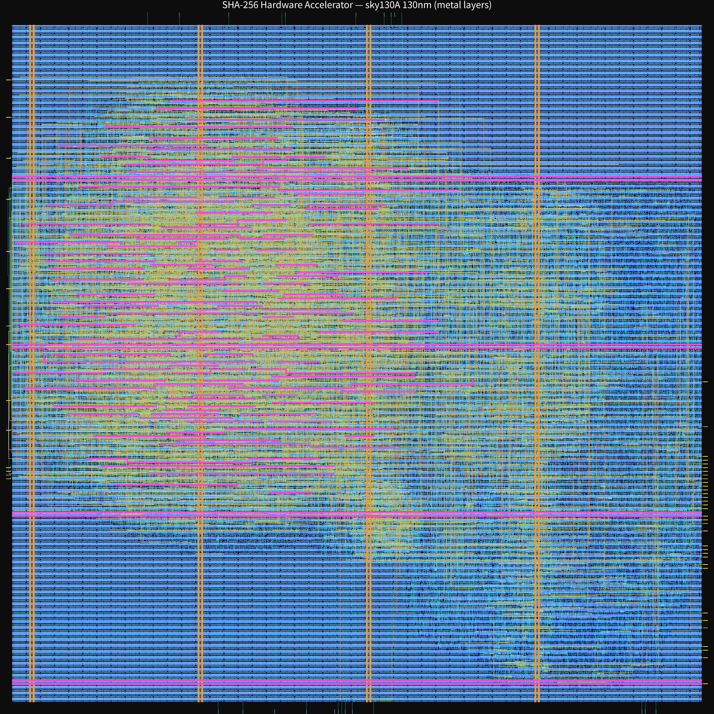
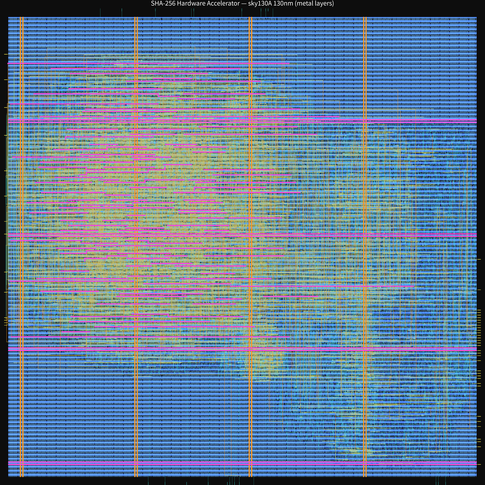
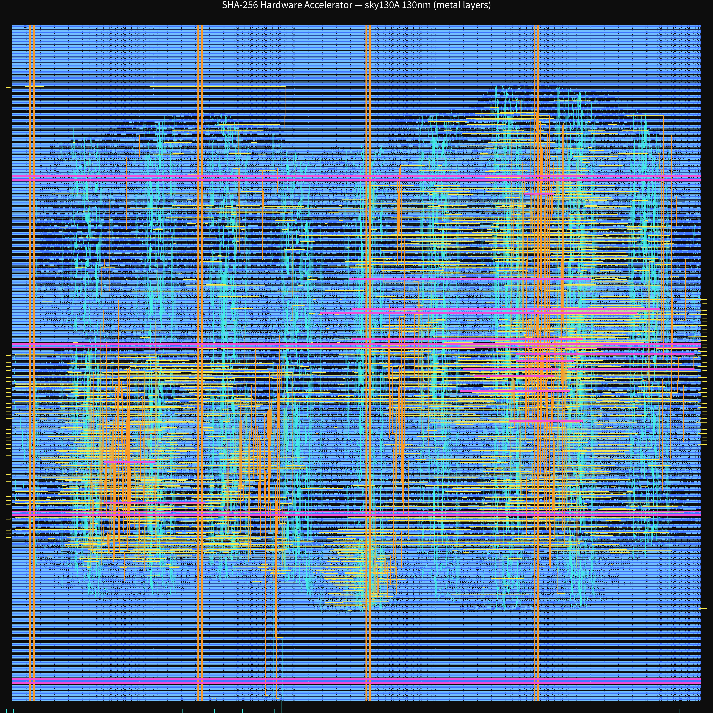

# SHA-256 硬件加速器 · OpenLane 零成本流片项目

从 RTL 一路做到真实 GDSII 版图的完整数字芯片设计闭环，基于 **OpenLane 1.1.1 + SkyWater sky130A（130nm）** 全开源工具链，零商业 EDA、零制造成本。七代迭代完成从“跑通流程”到“架构优化”“工艺边界识别”“面积与频率权衡”“时序签核收敛”“余量边界加压验证”，最后到“改架构把频率再推一档”的完整演进。

> **在线速览页（GitHub Pages）**：https://1ouxilisi.github.io/sha256-openlane-tapeout/ —— 七代演进、三 PVT corner 签核全表、七张版图、五层验证证据与边界说明，一页可读完。

> **设计说明（RTL 架构）**：[`docs/ARCHITECTURE.md`](docs/ARCHITECTURE.md) —— v1–v6 的三级流水与 W 窗口架构、v7 的移位寄存器消息调度与 AXI4-Lite 寄存器映射、频率的三种口径怎么读，以及明确列出的已知限制。


[](https://github.com/1ouxilisi/sha256-openlane-tapeout/actions/workflows/verify.yml)

> 一句话：一个人、一台云主机、零成本，把一条 SHA-256 加速器从 Verilog 做到可交付的 GDS 版图，并把每个工程决策用真实指标讲清楚——后三代把时序真正收敛到签核通过，并用加压实验探明余量边界；v7 换掉消息调度结构后，在同一块 die 上把频率从 41.67 MHz 推到 **55.56 MHz**。

---

## 成果速览（七代迭代）

| 版本 | run tag | 时钟频率 | 建议周期 | Die 面积 | 单元利用率 | 逻辑单元 | 布线违例 | 签核 WNS | GDS 大小 |
|---|---|---|---|---|---|---|---|---|---|
| v1 基础版（无流水线） | tapeout6 | 38.58 MHz | 25.92 ns | 0.64 mm² | 20.99% | 9512 | 0 | -15.92 | 38.9 MB |
| v2 二级流水 + 串行接口 | tapeout9 | 53.45 MHz | 18.71 ns | 0.49 mm² | 33.53% | 12245 | 0 | -8.71 | 43.3 MB |
| v3 三级流水 | tapeout10 | **58.17 MHz** | 17.19 ns | 0.49 mm² | 33.59% | 12288 | 0 | -7.19 | 41.6 MB |
| v4 收 die 面积优化 | tapeout12 | 56.72 MHz | 17.63 ns | **0.41 mm²** | **40.65%** | 12288 | 0 | -7.63 | 41.2 MB |
| v5 时序收敛版 | tapeout13 | 38.46 MHz | 26.00 ns | 0.41 mm² | 45.18% | 12288 | 0 | 0.00（全通过） | 43.4 MB |
| **v6 加压收敛版** | tapeout14 | **41.67 MHz** | **24.00 ns** | 0.41 mm² | 45.18% | 12288 | 0 | **0.00（全通过）** | 43.3 MB |
| v7 移位寄存器 + AXI-Lite（24 ns 口径） | tapeout15 | 41.67 MHz | 24.00 ns | 0.41 mm² | 45.77% | 11475 | 0 | **0.00（全通过，最紧 +6.44）** | 39.9 MB |
| **v7 最终版（18 ns 口径）** | tapeout16 | **55.56 MHz** | **18.00 ns** | 0.41 mm² | 45.77% | 11475 | 0 | **0.00（全通过，最紧 +0.56）** | 40.0 MB |

- **频率**：38.58 → 58.17 MHz 是"堆频率"阶段的顶点（v3）；v5 回落到 38.46 MHz 换取签核收敛；v6 在 v5 基础上把约束再压到 41.67 MHz，仍三 corner 全通过；**v7 不改流水深度，只把 W 的 16 深循环窗口换成移位寄存器，同 die 同库跑到 55.56 MHz，再压 33%**
- **面积**：0.64 → 0.41 mm²，缩小约 36%；v7 在同 die 下把逻辑单元从 12,288 降到 **11,475**（-6.6%），主要来自 mux 树消除
- **利用率**：约 21% → **45.77%**（v7 最高；v5/v6 为 45.18%，放宽约束后 resizer 少插缓冲）
- **质量**：七代详细布线 **DRC 0 违例**；v1–v4 的 SPEF/RCX 重签核 setup 余量为负；**v5 / v6 / v7 三代三 corner 全部 WNS = 0、TNS = 0**（v5 +5.00/+4.03/+3.12 ns，v6 +3.08/+2.12/+1.25 ns，v7@24ns +6.94/+6.70/+6.44 ns，v7@18ns +1.03/+0.80/+0.56 ns；hold 均 +0.40~+0.43 ns），是真正通过时序签核的三代
- **功能**：逻辑 11/11、核心仿真 12/12、顶层握手 3/3 全通过（v6 口径）；v7 另加压缩核 3/3 与 AXI 顶层 2/2（含一条**两块流式**用例），全部对照 Python `hashlib` 逐位一致

> v4 的取舍：以频率回落 1.45 MHz 换取利用率 +21%（33.59%→40.65%）、面积 -16%，是典型的面积/频率工程权衡。
> v5 的取舍：把时钟约束从"想要 100 MHz"改成"工艺真能给 26 ns"，频率回落至 38.46 MHz，换来 **时序签核首次全通过**。这是从"指标好看"转向"指标可信"的一代。
>
> v6 的取舍：在 v5 基础上把周期从 26.0 ns 压到 24.0 ns（41.67 MHz），RTL 与 die 一律不动，三 corner 仍全通过，最紧 setup 余量 +1.25 ns。它不追求再压，而是**测出余量边界**：按最紧角反推，该设计在 130nm 下的可达周期约 22.75 ns（≈43.9 MHz）。
>
> **v7 的取舍**：v6 那句话的适用条件是"这套 RTL 架构"。v7 把消息扩展的 16 深循环窗口（`(t-k)%16` 动态索引）换成 16 深移位寄存器，代价是 512 个 W 触发器每轮全翻转，收益是消掉 4 棵 16 选 1 mux 树——`mux2_2` 从 **2,239 降到 685**（mux 总数 2,239→794，-64.5%），逻辑单元总数 -6.6%。结果是同一块 0.41 mm² 的 die、同一个库、同一个时钟端口，在 **24 ns 下余量从 +1.25 放大到 +6.44**，于是 18.0 ns（55.56 MHz）三 corner 仍然全通过。
> **这就是"工艺上限"和"架构上限"的区别**：130nm 没有变，变的是被约束的逻辑。v6 的 22.75 ns 是旧架构的上限，不是工艺的上限。
> 代价也如实记：功耗从 6.84 mW（v6 @41.67 MHz）升到 9.41 mW（v7 @55.56 MHz），单位频率功耗基本持平（0.164→0.169 mW/MHz，+3.0%），**能量效率没有变好，只是同样能耗跑得更快**。

---

## 版图展示（七代）

以下为七代芯片版图的金属布线层渲染（sky130A 130nm），可直观看到 die 尺寸收敛与布线密度的变化。

**v1 基础版 · 0.64 mm² · 20.99% 利用率**


**v2 二级流水 · 0.49 mm² · 33.53% 利用率**


**v3 三级流水 · 0.49 mm² · 33.59% 利用率 · 58.17 MHz**


**v4 收 die · 0.41 mm² · 40.65% 利用率 · 56.72 MHz**


**v5 时序收敛版 · 0.41 mm² · 45.18% 利用率 · 38.46 MHz · 签核 WNS = 0**



**v6 加压收敛版 · 0.41 mm² · 45.18% 利用率 · 41.67 MHz · 24 ns 仍全通过**



**v7 移位寄存器 + AXI4-Lite（最终）· 0.41 mm² · 45.77% 利用率 · 55.56 MHz · 18 ns 三 corner 全通过**



---

## 设计架构

- **压缩核**：SHA-256 单块压缩（W 消息扩展 + A–H 状态更新），3 级流水线
  - phase0：W 扩展 `wc`
  - phase1：并行预计算 `t1p = H + Σ1 + Ch + K`、`t2p = Σ0 + Maj`
  - phase2：状态更新 `E = D + t1p + wc`、`A = t1p + wc + t2p`
- **顶层接口（v1–v6）**：32-bit 串行输入/输出 + `start/busy/done` 握手，显著压缩端口扇出（v1 的 773 并行 IO 是 die 偏大的主因）
- **顶层接口（v7）**：AXI4-Lite 从接口，寄存器映射 `0x00 CTRL(INIT)` / `0x04 STATUS(READY,BUSY)` / `0x08 MSG` / `0x0C MSGCNT` / `0x10–0x2C DIGEST0..7`；写满 16 个消息字自动启动压缩，压缩期间用 `awready/wready` 反压主机，链值在块之间保持，**多块流式不需要软件轮询**；padding 仍由软件完成
- **工艺**：sky130A，标准单元库 `sky130_fd_sc_hd`

---

## 仓库结构

```
openlane-chips/
├── designs/
│   └── sha256/
│       ├── src/
│       │   ├── sha256_pipe.v        # 3 级流水压缩核（当前版本）
│       │   ├── sha256_pipe_v2_backup.v
│       │   ├── sha256_top.v         # 顶层：32-bit 串行 + 握手
│       │   ├── sha256.v             # 早期单块组合版（对照用）
│       │   ├── sha256_tb.v          # 核心 testbench（12 组向量）
│       │   └── sha256_top_tb.v      # 顶层握手 testbench
│       ├── config.tcl               # OpenLane 配置（DIE_AREA 640×640 等）
│       ├── README.md                # 设计说明
│       └── VERIFICATION.md          # 验证报告
│   └── sha256_v7/                   # v7：移位寄存器压缩核 + AXI4-Lite 顶层
│       ├── src/sha256_core.v        # 压缩核（h_in/h_out 链值接口）
│       ├── src/sha256_axil.v        # AXI4-Lite 顶层（多块流式）
│       ├── tb/tb_v7_core.v          # 压缩核锚点向量（3 条）
│       ├── tb/tb_v7_axil.v          # AXI 握手 + 两块流式（2 条）
│       └── config.tcl               # OpenLane 配置（最终版 18.0 ns）
├── tapeout/
│   ├── deploy_openlane.sh           # 环境部署脚本
│   ├── run_sha256_flow.sh           # 一键跑流片
│   └── README.md                    # 流片包说明
├── tools/
│   ├── gen_sha256_tb.py             # 测试向量生成（对照 hashlib）
│   ├── sha256_logic_check.py        # 算法逻辑验证
│   ├── rtl_fsm_sim.py               # RTL 逐周期模拟
│   └── render_gds.py                # GDS → PNG 版图渲染
├── docs/
│   └── images/                      # 版图渲染图
└── 交付物（通过 Release 附件提供）
    ├── GDS × 6（v1–v6）
    ├── 版图 PNG × 6
    ├── metrics CSV × 6
    └── 项目报告（Word）
```

---

## 复现方式

### 环境要求

- Linux（Ubuntu 22.04+ 推荐），root 或 sudo
- 磁盘 ≥ 30 GB（OpenLane 全流程与中间产物约需 20–30 GB）
- 网络可访问 `github.com` 与 `hub.docker.com`
- 4 核 / 8 GB 内存以上

### 关键运行要点（踩坑记录）

- OpenLane rootfs 以 **chroot** 运行，flow 必须在 **`/designs` 根目录**启动（在 `/designs/sha256` 内启动会 prep 失败）
- 启动必须带齐环境变量：`TERM=xterm NO_COLOR=1 LC_ALL=C LANG=C PDK_ROOT=/pdk`
  （漏 `LC_ALL=C LANG=C` 会在 **STEP 0 verilator_lint_check** 直接失败）
- rootfs 默认 PATH **不包含 OpenLane 入口**，直接 `flow.tcl` 会报 `command not found`；须显式把 `nix/store/*-openlane1-1.1.1/bin` 加到 PATH
- chroot 内 KLayout 会在 STEP 37 崩溃（工具 bug），不影响 STEP 36 已产出的 GDS；版图渲染 / XOR 校验请在宿主机用 KLayout 0.30.x
- 布线拥塞时使用合法参数 `GRT_ALLOW_CONGESTION="1"` + `GRT_OVERFLOW_ITERS="200"` 让详细布线收敛

```bash
# 首次部署（Docker / Nix 路线见 tapeout/README.md）
sudo bash tapeout/deploy_openlane.sh

# 跑流片
sudo bash tapeout/run_sha256_flow.sh
# GDS 产出：designs/sha256/runs/<tag>/results/final/gds/sha256_top.gds
```

> `metrics.csv` 中 `flow_status` 显示 `flow failed`，系 STEP 37 chroot KLayout 崩溃所致，与设计无关；此前 GDSII 已正常产出，全部指标与版图数据有效。

---

## 验证与质量

| 层 | 内容 | 结果 |
|---|---|---|
| L1 算法逻辑 | K 常量、σ/Σ、Ch/Maj、64 轮压缩（对照 Python hashlib） | 11/11 PASS |
| L2 核心时序 | iverilog 逐周期仿真，12 组标准向量 | 12/12 PASS |
| L3 SoC 握手 | start→busy→done→digest 时序 | 3/3 PASS（v3 起；v1/v2 为 2/2） |
| L3+ v7 压缩核 | 移位寄存器核单块锚点（abc / empty / fox） | 3/3 PASS |
| L3+ v7 AXI 顶层 | AXI4-Lite 读写握手 + 单块 + 两块流式链值 | 2/2 PASS |
| L4 v7 静态 lint | verilator 5.018 `--lint-only -Wall --top-module sha256_axil` | 0 error / **0 warning** |

物理验证：七代详细布线 **DRC 0 违例**（v4 经 14 轮迭代从 16,283 收敛到 0）；Magic 与 KLayout 双工具 GDS 逐层 XOR 比对，**七代均为 40/41 层共同层零差异**（唯一差异为标定层 81/14，非结构层）。

**一键复现（任何人都能在本地重跑）**

```bash
bash scripts/verify.sh            # 编译 RTL + testbench，跑 abc / empty / fox 三条锚点，输出 ALL TESTS PASSED
python3 scripts/check_vectors.py  # 用 Python hashlib 独立核对 testbench 里的期望值，防止"自己验自己"
bash scripts/lint_check.sh        # verilator 静态 lint，除两条已豁免的位宽扩展告警外要求干净

# v7（AXI4-Lite 顶层）：编译两个源文件 + 两个 testbench
iverilog -g2005 -o simv designs/sha256_v7/tb/tb_v7_core.v designs/sha256_v7/src/sha256_core.v && ./simv
iverilog -g2005 -o simax designs/sha256_v7/tb/tb_v7_axil.v designs/sha256_v7/src/sha256_axil.v designs/sha256_v7/src/sha256_core.v && ./simax
```

仓库内置 GitHub Actions（`.github/workflows/verify.yml`），每次 push 都会在干净环境里重跑上面三步（仿真 / 向量核对 / lint），状态见顶部 badge。这条链路的意义不是多一次仿真，而是把"我验证过"变成"你可以自己验证"。

**综合层对照（可选，需本地 PDK）**

```bash
bash scripts/synth_check.sh       # 裸 yosys + sky130 liberty，输出 cells 数与面积
```

用 yosys 0.38 加 `sky130_fd_sc_hd__tt_025C_1v80.lib` 独立综合 v6 的 RTL，得到 **9,248 cells**；OpenLane 记录的综合结果是 **12,288 cells**，其中 **2,532 个是 `buf_1`**，剔除 buffer 后净逻辑约 **9,756**，两者相差 5%。也就是说 12,288 不是一个流程黑箱数字——换一套完全不依赖 OpenLane 的最小流程，也能在真实工艺库上映射出同量级网表。

> 边界：裸 yosys 不插 buffer、不做时序驱动映射，也不等价于 OpenLane 的综合链，因此不追求逐单元一致；这一步只证明"可综合、可映射到 sky130"，不作通过/失败判据。它需要本地 PDK，因此没有放进 CI（避免每次 push 拉 12 MB liberty）。

签核数据（SPEF/RCX 驱动三 PVT corner）：

| 版本 | setup WNS min / nom / max | TNS nom | hold 最差 (nom) | 功耗 (nom) |
|---|---|---|---|---|
| v1 | -14.97 / -15.92 / -16.84 | -4286.12 | -0.33 | 10.8 mW |
| v2 | -7.74 / -8.71 / -9.62 | -711.56 | -0.24 | 15.0 mW |
| v3 | -6.45 / -7.19 / -7.97 | -637.46 | -0.16 | 15.1 mW |
| v4 | -6.63 / -7.63 / -8.44 | -570.30 | -0.45 | 16.3 mW |
| v5 | +5.00 / +4.03 / +3.12 | 0.00 | +0.43 | 6.31 mW |
| **v6** | **+3.08 / +2.12 / +1.25** | **0.00** | **+0.43** | **6.84 mW** |
| v7 @24 ns | +6.94 / +6.70 / +6.44 | 0.00 | +0.40 | 7.06 mW |
| **v7 @18 ns（最终）** | **+1.03 / +0.80 / +0.56** | **0.00** | **+0.40** | **9.41 mW** |

> **诚实说明**：v1–v4 表中"优化后 WNS = 0"是布线后 resizer 的估算值；用 SPEF 寄生重新签核后 setup 余量均为负、hold 也有缺口，那四代**按时序签核标准判定不合格**。v5 不改 RTL，只把时钟约束从 10.0 ns（自己想要 100 MHz）改成 26.0 ns（工艺实际能给），并加 setup/hold 余量，结果三 corner 全部转正、TNS 归零——这是本项目唯一能拿去做时序签核的一代。代价是频率只有 38.46 MHz：**干净的 38 MHz 比不收敛的 57 MHz 更有工程价值**。
>
> v5 功耗 6.31 mW 与 v4 的 16.3 mW 不可直接比较（频率不同），但两者结构一致：时钟树 49.0% + 触发器 48.2% = 97.2%，组合逻辑不足 3%。v6 为 6.84 mW，结构仍是时钟树 49.1% + 触发器 48.1% = 97.2%。这解释了为什么继续优化组合路径既不提频也不省电。
>
> **功耗口径**：表中“功耗 (nom)”指 nom corner 的 RC 提取（`33-rcx_mcsta.nom`）下 **Fastest 工艺角**（`ff_n40C_1v95.lib`）的总功耗——三组里最保守的那个。同一次分析中 v6 的 Typical / Slowest 为 5.46 / 7.97 mW，v7@24ns 为 5.60 / 8.23 mW，v7@18ns 为 7.44 / 11.0 mW。跨版本比较必须同角对同角，否则会把“换工艺角”误读成“功耗变化”。
>
> **v6 的定位**：v5 证明了"约束对就能签核"，v6 证明"余量还有多少"。v6 把周期从 26.0 ns 压到 24.0 ns，三 corner 余量由 +5.00/+4.03/+3.12 收窄为 +3.08/+2.12/+1.25 ns，仍全部为正。它不是更快的一代，而是把上一代的余量量化成一条边界：约 22.75 ns（43.9 MHz）是这条 RTL 在 sky130A 上的实际上限。

---

## 工艺边界与设计结论

- 3 级流水将每级组合逻辑压到约 6.6 ns，但 signoff 关键路径周期为 17.6 ns，差额来自 **130nm 标准单元寄存器 CK-to-Q 延迟 + 布线 RC 互连**，这是该工艺下流水线化的物理上限
- 频率曲线 38.58 → 53.45 → 58.17 → 56.72 MHz 呈边际递减：v2 相对 v1 +38%，v3 相对 v2 仅 +9%
- 结论：58 MHz 已接近该工艺下本设计的合理工作频率；继续加流水级收益有限
- v5 给出反证：同一 RTL 在 26 ns 约束下三 corner 全通过、setup 余量最少 3.12 ns，说明 **v1–v4 的负余量不是设计缺陷，而是约束偏离实际工艺能力的产物**。约束该跟着工艺走，而不是跟着愿望走
- v6 给出定量边界：24 ns 约束下三 corner 余量收窄到最少 1.25 ns 仍全通过；把余量加回周期即得可达周期约 22.75 ns（≈43.9 MHz）。这句话的前提是"v6 的 RTL"——**它不是工艺上限**
- v7 给出反证：把 W 的循环窗口换成移位寄存器（mux 总数 -64.5%、逻辑单元 -6.6%），同一块 die、同一个库、同一个时钟端口，24 ns 下余量从 +1.25 放大到 +6.44，于是 **18.0 ns（55.56 MHz）三 corner 仍全正余量（最紧 +0.56 ns）**。说明此前撞到的是**架构上限**，不是 130nm 的上限
- 由此得到的判据：真正该问的不是"这颗芯片能跑多快"，而是"**在这个结构下**能跑多快"。改结构能换来的余量，比在约束上反复试探大得多

---

## 技术栈

| 环节 | 工具 |
|---|---|
| 逻辑综合 | Yosys |
| 布局 / 布线 / 时序 | OpenROAD |
| 详细布线 | TritonRoute |
| 物理验证 | Magic、KLayout |
| PDK 管理 | volare（sky130A，commit `bdc9412b`） |
| 全流程集成 | OpenLane 1.1.1 |

---

## 许可与致谢

本项目按产出类型采用双许可：

- **硬件设计 → CERN-OHL-P-2.0**，全文见 [LICENSE-HARDWARE](LICENSE-HARDWARE)
  - 适用范围：RTL 源码（`designs/sha256/src/*.v`、`designs/sha256_v7/src/*.v`）、测试平台，以及 Release 附件中的七代 GDS
  - 该许可允许使用、修改、制造与商业分发，要求保留声明并在修改处标注变更
- **代码与文档 → Apache-2.0**，全文见 [LICENSE](LICENSE)
  - 适用范围：流程脚本（`tapeout/`）、工具脚本（`tools/`）、说明文档（`README.md`、`docs/`，含版图渲染图）
  - 含专利授权条款，适合被工程环境复用
- **第三方组件**：SkyWater sky130A PDK、OpenLane / OpenROAD / Yosys / Magic / KLayout 均按各自许可证使用，不随本仓库分发
  - 引用或复用时请保留本许可证与原始版权声明
- 本项目基于开源生态完成，致谢 OpenLane、OpenROAD、Yosys、SkyWater PDK 等开源社区

---

## 说明

本仓库为个人作品集性质的开源流片记录，目标不是量产商用芯片，而是完整验证“零成本完成数字芯片 RTL→GDS 全流程”这一路径的可行性与工程质量。v7 加了 AXI4-Lite 与多块流式后，它仍然**不是一个能进产品线的 IP**：吞吐约 12–15 MB/s（比带 SHA-NI 的 CPU 慢两个数量级），无 DFT 扫链、无 silicon 验证。它证明的是工程链路，不是商用可用性。

---

## 引用

仓库带 `CITATION.cff`，在 GitHub 页面上点 **Cite this repository** 可直接导出 APA / BibTeX：

```
@misc{1ouxilisi_sha256_openlane_tapeout,
  title  = {SHA-256 Accelerator: zero-cost open-source tapeout on SkyWater sky130A with OpenLane},
  author = {1ouxilisi},
  year   = {2026},
  note   = {v1.0.0, seven generations, GDSII + metrics + signoff}
}
```

代码 `LICENSE` 为 Apache-2.0；RTL 与 GDSII `LICENSE-HARDWARE` 为 CERN-OHL-P-2.0。
