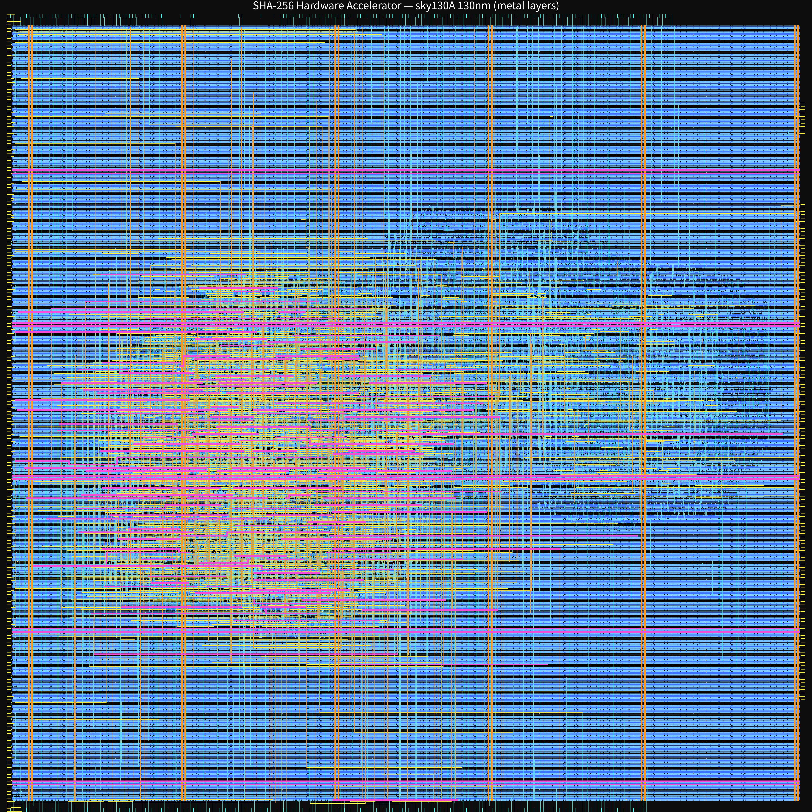
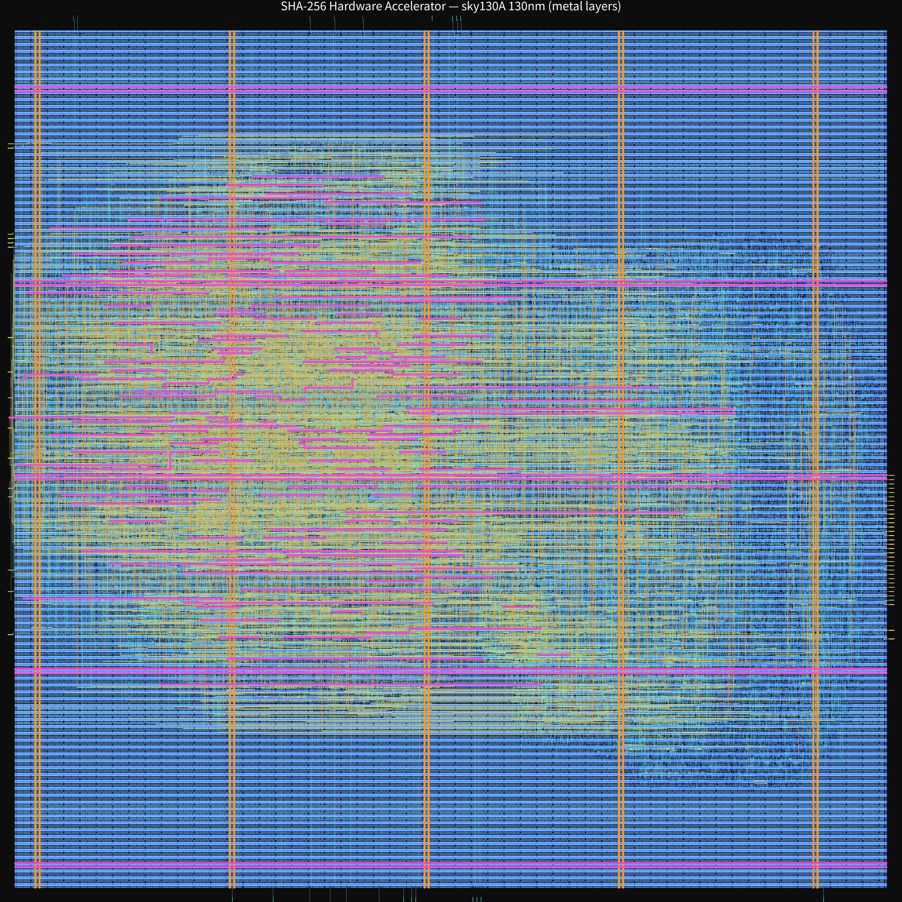
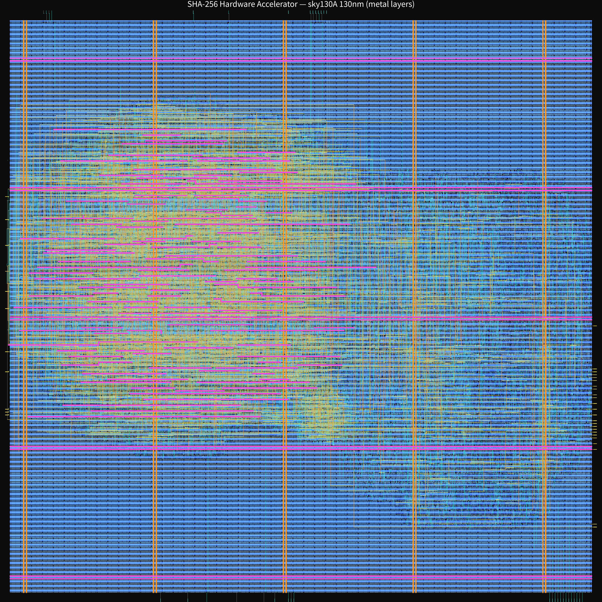
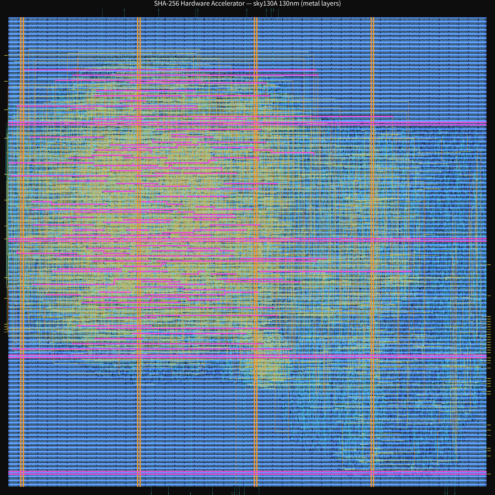

# SHA-256 硬件加速器 · OpenLane 零成本流片项目

从 RTL 一路做到真实 GDSII 版图的完整数字芯片设计闭环，基于 **OpenLane 1.1.1 + SkyWater sky130A（130nm）** 全开源工具链，零商业 EDA、零制造成本。四代迭代完成从“跑通流程”到“架构优化”“工艺边界识别”“面积与频率权衡”的完整演进。

> 一句话：一个人、一台云主机、零成本，把一条 SHA-256 加速器从 Verilog 做到可交付的 GDS 版图，并把每个工程决策用真实指标讲清楚。

---

## 成果速览（四代迭代）

| 版本 | run tag | 时钟频率 | 建议周期 | Die 面积 | 单元利用率 | 逻辑单元 | 布线违例 | GDS 大小 |
|---|---|---|---|---|---|---|---|---|
| v1 基础版（无流水线） | tapeout6 | 38.58 MHz | 25.92 ns | 0.64 mm² | 20.99% | 9512 | 0 | 38.9 MB |
| v2 二级流水 + 串行接口 | tapeout9 | 53.45 MHz | 18.71 ns | 0.49 mm² | 33.53% | 12245 | 0 | 43.3 MB |
| v3 三级流水 | tapeout10 | **58.17 MHz** | 17.19 ns | 0.49 mm² | 33.59% | 12288 | 0 | 41.6 MB |
| v4 收 die 面积优化 | tapeout12 | 56.72 MHz | 17.63 ns | **0.41 mm²** | **40.65%** | 12288 | 0 | 41.2 MB |

- **频率**：38.58 → 58.17 MHz，累计 +51%（v4 因收紧 die 小幅回落至 56.72 MHz）
- **面积**：0.64 → 0.41 mm²，缩小约 36%
- **利用率**：约 21% → **40.65%**，突破 40% 目标
- **质量**：四代全部 **0 布线违例**，优化后 WNS 自 v2 起均为 0（时序收敛）
- **功能**：三层验证全通过（逻辑 11/11、核心仿真 12/12、顶层握手 2/2），锚点向量 `abc` / `empty` / `fox` 摘要逐位一致

> v4 的取舍：以频率回落 1.45 MHz 换取利用率 +21%（33.59%→40.65%）、面积 -16%，是典型的面积/频率工程权衡，也是本项目从“堆频率”转向“懂权衡”的标志。

---

## 版图展示（四代）

以下为四代芯片版图的金属布线层渲染（sky130A 130nm），可直观看到 die 尺寸收敛与布线密度的变化。

**v1 基础版 · 0.64 mm² · 20.99% 利用率**



**v2 二级流水 · 0.49 mm² · 33.53% 利用率**



**v3 三级流水 · 0.49 mm² · 33.59% 利用率 · 58.17 MHz**



**v4 收 die（最终版）· 0.41 mm² · 40.65% 利用率 · 56.72 MHz**



---

## 设计架构

- **压缩核**：SHA-256 单块压缩（W 消息扩展 + A–H 状态更新），3 级流水线
  - phase0：W 扩展 `wc`
  - phase1：并行预计算 `t1p = H + Σ1 + Ch + K`、`t2p = Σ0 + Maj`
  - phase2：状态更新 `E = D + t1p + wc`、`A = t1p + wc + t2p`
- **顶层接口**：32-bit 串行输入/输出 + `start/busy/done` 握手，显著压缩端口扇出（v1 的 773 并行 IO 是 die 偏大的主因）
- **工艺**：sky130A，标准单元库 `sky130_fd_sc_hd`

---

## 仓库结构

```
openlane-chips/
├── designs/
│   └── sha256/
│       ├── src/
│       │   ├── sha256_pipe.v        # 3 级流水压缩核（当前版本）
│       │   ├── sha256_pipe_v2_backup.v
│       │   ├── sha256_top.v         # 顶层：32-bit 串行 + 握手
│       │   ├── sha256.v             # 早期单块组合版（对照用）
│       │   ├── sha256_tb.v          # 核心 testbench（12 组向量）
│       │   └── sha256_top_tb.v      # 顶层握手 testbench
│       ├── config.tcl               # OpenLane 配置（DIE_AREA 640×640 等）
│       ├── README.md                # 设计说明
│       └── VERIFICATION.md          # 验证报告
├── tapeout/
│   ├── deploy_openlane.sh           # 环境部署脚本
│   ├── run_sha256_flow.sh           # 一键跑流片
│   └── README.md                    # 流片包说明
├── tools/
│   ├── gen_sha256_tb.py             # 测试向量生成（对照 hashlib）
│   ├── sha256_logic_check.py        # 算法逻辑验证
│   ├── rtl_fsm_sim.py               # RTL 逐周期模拟
│   └── render_gds.py                # GDS → PNG 版图渲染
├── docs/
│   └── images/                      # 版图渲染图
└── 交付物（通过 Release 附件提供）
    ├── GDS × 4（v1–v4）
    ├── 版图 PNG × 4
    ├── metrics CSV × 4
    └── 项目报告（Word）
```

---

## 复现方式

### 环境要求

- Linux（Ubuntu 22.04+ 推荐），root 或 sudo
- 磁盘 ≥ 30 GB（OpenLane 全流程与中间产物约需 20–30 GB）
- 网络可访问 `github.com` 与 `hub.docker.com`
- 4 核 / 8 GB 内存以上

### 关键运行要点（踩坑记录）

- OpenLane rootfs 以 **chroot** 运行，flow 必须在 **`/designs` 根目录**启动（在 `/designs/sha256` 内启动会 prep 失败）
- 启动必须带齐环境变量：`TERM=xterm NO_COLOR=1 LC_ALL=C LANG=C PDK_ROOT=/pdk`
  （漏 `LC_ALL=C LANG=C` 会在 **STEP 0 verilator_lint_check** 直接失败）
- chroot 内 KLayout 会在 STEP 37 崩溃（工具 bug），不影响 STEP 36 已产出的 GDS；版图渲染 / XOR 校验请在宿主机用 KLayout 0.30.x
- 布线拥塞时使用合法参数 `GRT_ALLOW_CONGESTION="1"` + `GRT_OVERFLOW_ITERS="200"` 让详细布线收敛

```bash
# 首次部署（Docker / Nix 路线见 tapeout/README.md）
sudo bash tapeout/deploy_openlane.sh

# 跑流片
sudo bash tapeout/run_sha256_flow.sh
# GDS 产出：designs/sha256/runs/<tag>/results/final/gds/sha256_top.gds
```

> `metrics.csv` 中 `flow_status` 显示 `flow failed`，系 STEP 37 chroot KLayout 崩溃所致，与设计无关；此前 GDSII 已正常产出，全部指标与版图数据有效。

---

## 验证与质量

| 层 | 内容 | 结果 |
|---|---|---|
| L1 算法逻辑 | K 常量、σ/Σ、Ch/Maj、64 轮压缩（对照 Python hashlib） | 11/11 PASS |
| L2 核心时序 | iverilog 逐周期仿真，12 组标准向量 | 12/12 PASS |
| L3 SoC 握手 | start→busy→done→digest 时序 | 3/3 PASS（v3 起；v1/v2 为 2/2） |

物理验证：四代详细布线 **0 违例**、DRC **0 违例**；Magic 与 KLayout 双工具 GDS 逐层 XOR 比对，**四代均为 40 层共同层零差异**（唯一差异为标定层 81/14，非结构层）。

---

## 工艺边界与设计结论

- 3 级流水将每级组合逻辑压到约 6.6 ns，但 signoff 关键路径周期为 17.6 ns，差额来自 **130nm 标准单元寄存器 CK-to-Q 延迟 + 布线 RC 互连**，这是该工艺下流水线化的物理上限
- 频率曲线 38.58 → 53.45 → 58.17 → 56.72 MHz 呈边际递减：v2 相对 v1 +38%，v3 相对 v2 仅 +9%
- 结论：58 MHz 已接近该工艺下本设计的合理工作频率；继续加流水级收益有限，转向面积优化（v4）是更成熟的选择

---

## 技术栈

| 环节 | 工具 |
|---|---|
| 逻辑综合 | Yosys |
| 布局 / 布线 / 时序 | OpenROAD |
| 详细布线 | TritonRoute |
| 物理验证 | Magic、KLayout |
| PDK 管理 | volare（sky130A，commit `bdc9412b`） |
| 全流程集成 | OpenLane 1.1.1 |

---

## 许可与致谢

本项目按产出类型采用双许可：

- **硬件设计 → CERN-OHL-P-2.0**，全文见 [LICENSE-HARDWARE](LICENSE-HARDWARE)
  - 适用范围：RTL 源码（`designs/sha256/src/*.v`）、测试平台，以及 Release 附件中的四代 GDS
  - 该许可允许使用、修改、制造与商业分发，要求保留声明并在修改处标注变更
- **代码与文档 → Apache-2.0**，全文见 [LICENSE](LICENSE)
  - 适用范围：流程脚本（`tapeout/`）、工具脚本（`tools/`）、说明文档（`README.md`、`docs/`，含版图渲染图）
  - 含专利授权条款，适合被工程环境复用
- **第三方组件**：SkyWater sky130A PDK、OpenLane / OpenROAD / Yosys / Magic / KLayout 均按各自许可证使用，不随本仓库分发
  - 引用或复用时请保留本许可证与原始版权声明
- 本项目基于开源生态完成，致谢 OpenLane、OpenROAD、Yosys、SkyWater PDK 等开源社区

---

## 说明

本仓库为个人作品集性质的开源流片记录，目标不是量产商用芯片，而是完整验证“零成本完成数字芯片 RTL→GDS 全流程”这一路径的可行性与工程质量。
